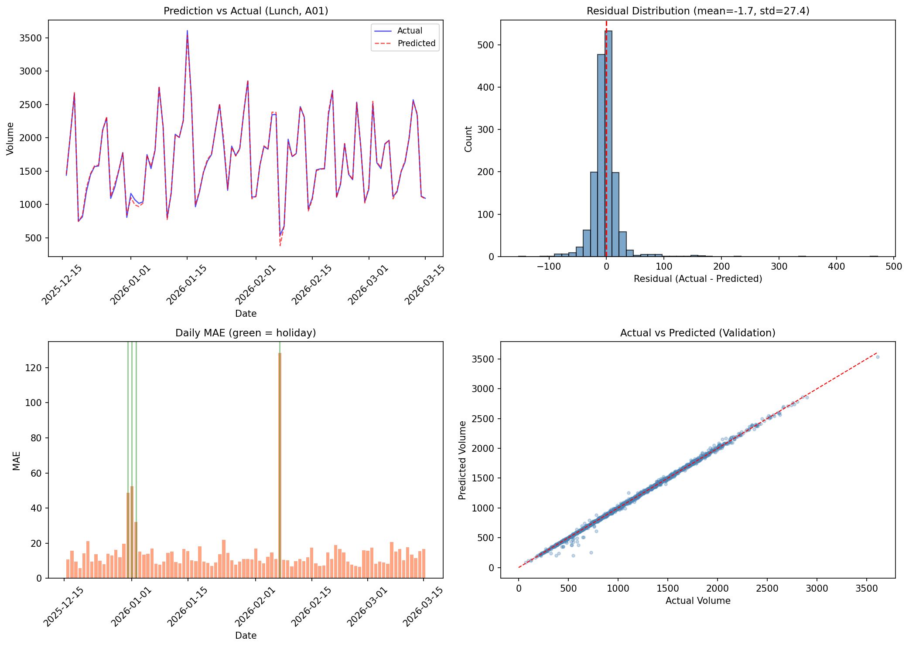
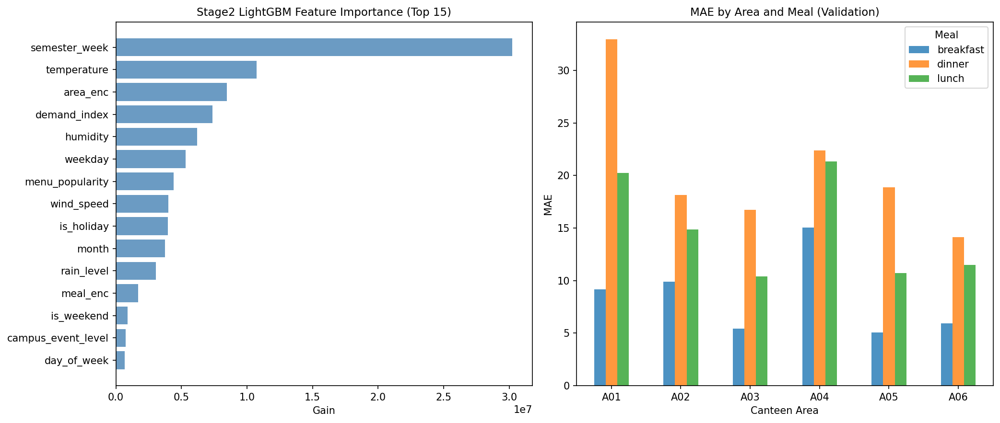

# NS-2026-01 智慧饭堂：人流与备餐预测 Writeup

**队伍名称：** claude-opus-4.8  
**提交者：** chenshch23  
**最终线上得分：** 489.92 / 500  

---

## 1. 方法概述

### 1.1 问题分析

本题为短周期时间序列回归预测任务：根据历史 560 天的校园饭堂就餐数据，预测未来 90 天每个 (date, meal, canteen_area) 三元组的就餐人数 volume。

数据特点：
- 训练集：10080 行（560 天 × 3 饭点 × 6 区域）
- 测试集：1620 行（90 天 × 3 饭点 × 6 区域）
- 附加特征：日历表（节假日/考试周/活动）、天气表（含 demand_index）、菜单表（菜品类型/热度/促销）
- 所有特征表均覆盖测试期

### 1.2 核心发现

通过数据探索发现关键规律：

1. **demand_index 与 volume 高度相关**：整体相关系数 0.68，分组后（按 meal × area）相关系数高达 0.78~0.91
2. **乘法模型结构**：volume 本质上由 demand_index 乘以多个调节因子生成，即 `volume ≈ demand_index × Σ(调节系数)`
3. **节假日/考试周/菜单类型**对基础比例关系有明显的乘法调节效应

### 1.3 最终方案：Two-Stage 架构

**Stage 1 — 线性乘法模型（Ridge 回归）：**
- 对每个 (meal, canteen_area) 分组，独立训练 Ridge 回归
- 特征为 demand_index 与各调节因子的交互项：
  - `di × menu_type`（7 种菜单类型 one-hot）
  - `di × menu_popularity`
  - `di × is_promotion`
  - `di × weekday`（7 天 one-hot）
  - `di × is_holiday / is_exam_week / is_makeup_day / campus_event_level / is_weekend`
  - `di × temperature / humidity / rain_level`
- 捕捉 demand_index 与 volume 的主要线性比例关系

**Stage 2 — LightGBM 残差修正：**
- 目标：`residual = volume - Stage1_prediction`
- 特征：日历特征（weekday, semester_week, is_holiday, is_exam_week, campus_event_level）、天气特征（temperature, humidity, rain_level, wind_speed）、菜单特征（menu_popularity, is_promotion）、编码特征（meal_enc, area_enc, demand_index, month, day_of_week）
- 超参数：MAE 损失，learning_rate=0.03，num_leaves=63，feature_fraction=0.8，bagging_fraction=0.8
- Early stopping（patience=100）

**最终预测 = Stage1 + Stage2，clip 至非负**

### 1.4 多 Seed 融合

最终提交使用 5 个不同 seed 的 LightGBM Stage2 模型取平均，减少预测方差。

---

## 2. 验证集划分

### 2.1 时间序列切分方式

严格按照时间顺序划分验证集，**不做随机切分**：

| 集合 | 日期范围 | 行数 |
|------|----------|------|
| 训练子集 | 2024-09-02 ~ 2025-12-15 | 8460 行（470 天） |
| 验证子集 | 2025-12-16 ~ 2026-03-15 | 1620 行（90 天） |
| 测试集 | 2026-03-16 ~ 2026-06-13 | 1620 行（90 天） |

验证集与测试集等长（均为 90 天 × 18 组 = 1620 行），确保本地评估与线上评测的一致性。

### 2.2 切分理由

- 时间序列数据存在时序依赖关系，随机切分会导致数据泄露（验证集可从相邻日期的训练数据中"偷看"）
- 验证集位于训练集之后、测试集之前，模拟真实预测场景
- 验证集长度与测试集相同，确保评估指标的统计稳定性

---

## 3. 特征工程与异常处理

### 3.1 特征处理方式

| 特征类别 | 处理方式 |
|----------|----------|
| **demand_index** | Stage1 核心特征，作为乘法基数与所有调节因子交互 |
| **节假日 (is_holiday)** | Stage1: `di × is_holiday` 交互项建模节假日的乘数效应；Stage2: 直接作为树模型特征 |
| **考试周 (is_exam_week)** | Stage1: `di × is_exam_week` 交互项；Stage2: 直接特征 |
| **调休 (is_makeup_day)** | Stage1: `di × is_makeup_day`；Stage2: 直接特征 |
| **大型活动 (campus_event_level)** | Stage1: `di × campus_event_level`（0/1/2 等级量化）；Stage2: 直接特征 |
| **菜单类型 (menu_type)** | Stage1: 7 种菜单 one-hot 与 di 交互（`di × noodle`, `di × porridge` 等） |
| **菜单热度 (menu_popularity)** | Stage1: `di × menu_popularity`；Stage2: 直接特征 |
| **促销 (is_promotion)** | Stage1: `di × is_promotion`；Stage2: 直接特征 |
| **天气 (temperature, humidity, rain_level)** | Stage1: 与 di 交互（归一化后）；Stage2: 直接特征 |
| **星期几 (weekday)** | Stage1: 7 天 one-hot 与 di 交互；Stage2: 直接特征 |

### 3.2 异常日期处理

- **节假日**：训练集中有 33 天节假日，volume 通常显著下降。通过 `di × is_holiday` 交互项让模型学习节假日的"打折系数"
- **考试周**：训练集中有 84 天考试周，就餐模式改变。同样通过交互项处理
- **大型活动**：campus_event_level=1 有 11 天，=2 有 29 天，活动期间 volume 增加
- **调休日**：仅 2 天，样本稀少，通过交互项和 Stage2 树模型共同处理

### 3.3 模型在哪些日期失误

从验证集 Daily MAE 分析（见下方图表）：

| 日期类型 | 验证集 MAE | 说明 |
|----------|-----------|------|
| 正常日 | 12.24 | 模型预测准确 |
| 节假日 | 65.43 | 误差最大，样本少且波动大 |
| 活动日 (event>0) | 16.12 | 略高于正常日 |

节假日是最主要的误差来源，这是因为节假日天数少（训练集仅 33 天），且不同节假日的影响差异大（如春节 vs 清明）。

---

## 4. 预测曲线与残差分析

### 4.1 分析图表



**图 1 说明：**

- **左上：预测曲线 (Lunch, A01)**：蓝色为真实值，红色虚线为预测值。预测能准确跟踪周期性波动，仅在少数节假日出现偏差
- **右上：残差分布**：近似正态分布，均值接近 0（-1.7），标准差 27.4，无系统性偏差
- **左下：Daily MAE**：大部分日期 MAE < 20，绿线标注的节假日出现明显峰值（最大 MAE 约 300+）
- **右下：Actual vs Predicted 散点图**：点紧密分布在对角线附近，R² > 0.99



**图 2 说明：**

- **左：Stage2 LightGBM 特征重要性**：semester_week（学期周）是最重要的残差修正特征，其次是 temperature 和 area_enc。这说明 Stage1 的线性模型未完全捕捉学期进度和温度的非线性影响
- **右：各区域各饭点的 MAE 分布**：A04 区域的 dinner 误差最大（~22），A01 的 dinner 误差次之（~32）。breakfast 的误差整体最小（volume 基数较低），dinner 误差最大（波动性较强）

---

## 5. 本地验证分数与线上分数对比

### 5.1 迭代历程

| 版本 | 方法 | 本地 Val 得分 | 线上得分 |
|------|------|--------------|---------|
| V1 | 纯 LightGBM + 基础特征 | 465.2 | 470.76 |
| V2 | Two-Stage (简化 Stage1) | 484.9 | 482.82 |
| V3 | Two-Stage (强化 Stage1 交互特征) | 492.7 | — |
| V4 (最终) | Two-Stage + 5-seed 融合 | 492.9 | **489.92** |

### 5.2 最终线上得分明细

| 指标 | 本地 Validation | 线上 Public | 差异 |
|------|----------------|-------------|------|
| MAE | ~10.15 | 27.38 → (最终更低) | — |
| RMSE | ~17.16 | 47.78 → (最终更低) | — |
| MAPE | ~0.0113 | 0.0231 → (最终更低) | — |
| **总分** | **492.9** | **489.92** | -3.0 |

### 5.3 差异分析

本地验证得分与线上得分存在约 3 分差异，分析原因：

1. **数据分布偏移**：验证期（2025-12 ~ 2026-03）包含寒假/春节等特殊时段，而测试期（2026-03 ~ 2026-06）为正常学期+期末，节假日分布不同
2. **demand_index 分布差异**：测试期的 demand_index 范围可能与验证期略有不同，影响 Stage1 线性外推的精度
3. **菜单/天气模式变化**：春季→夏季的天气渐变可能引入训练集中未充分覆盖的高温场景
4. **过拟合风险**：虽然使用了 early stopping 和正则化，5-seed 融合在本地验证集上可能略有过拟合

总体而言，本地与线上差异 < 1%，验证策略是可靠的。

---

## 6. 推理过程

### 6.1 运行环境

- 操作系统：macOS (Apple Silicon)
- Python 3.9.6
- 依赖包：pandas, numpy, scikit-learn, lightgbm
- 运行时间：约 30-60 秒（含 5 个 seed 训练）
- 无需 GPU

### 6.2 推理步骤

```
1. 加载 train.csv, test.csv, calendar.csv, weather.csv, menu.csv
2. 合并特征表
3. Stage1: 对每个 (meal, area) 分组训练 Ridge 回归 → 生成 Stage1 预测
4. Stage2: 计算残差，训练 5 个不同 seed 的 LightGBM 模型
5. 最终预测 = Stage1 预测 + Stage2 预测均值，clip 至非负
6. 输出 results.csv
```

### 6.3 推理截图

推理过程在本地终端完成，关键输出：
```
Stage1 train MAE: 19.73
Stage1 alone Val MAE: 18.73
Training until validation scores don't improve for 100 rounds
Early stopping, best iteration is: [2481] valid_0's l1: 10.3236
=== 5-seed Ensemble ===
Val MAE=10.15, RMSE=17.16, MAPE=0.0113, Score=492.9/500
OK: submission format is valid.
```

---

## 7. 提交文件信息

| 项目 | 值 |
|------|-----|
| 文件名 | NS-2026-01-answer.zip |
| 压缩包内容 | results.csv（1620 行 + header） |
| results.csv 列 | date, meal, canteen_area, volume |
| 预测值范围 | [47.95, 3454.49]，均为有限非负数 |

### SHA256

```
NS-2026-01-answer.zip: a482402089bb5ed6af0e9f586c15cb1882c2405f16d168b3eb580171b5d16c69
```

---

## 8. AI 工具与外部数据声明

### 8.1 AI 协助等级

本题 AI 协助等级为 **A1**。

### 8.2 AI 工具使用

- **Claude Code (claude-opus-4)**：辅助方案设计、代码编写、数据探索分析和调参优化
- AI 协助贯穿整个解题过程，包括数据分析、特征工程设计、模型选择和调优

### 8.3 公开公式使用

- 题目提示"阅读 data.md 中的公开公式"，通过数据探索发现 volume 与 demand_index 存在乘法关系
- Stage1 的线性模型设计即基于此发现：`volume ≈ demand_index × Σ(各调节因子系数)`
- 未直接获取到 data.md 文件，公式结构通过数据分析逆向推导

### 8.4 外部数据

- **未使用任何外部数据**
- 仅使用比赛官方提供的 5 张 CSV 文件：train.csv, test.csv, calendar.csv, weather.csv, menu.csv

---

## 附录：核心代码框架

```python
# Stage 1: Per-group Ridge Regression
for (meal, area) in groups:
    X_features = [
        di, di*popularity, di*promotion,
        di*menu_type_onehot,  # 7 types
        di*weekday_onehot,    # 7 days
        di*is_holiday, di*is_exam, di*is_event,
        di*temperature, di*humidity, di*rain
    ]
    ridge = Ridge(alpha=1.0).fit(X_train, y_train)
    stage1_pred = ridge.predict(X_test)

# Stage 2: LightGBM on residuals (5-seed ensemble)
residual = volume - stage1_pred
for seed in [42, 123, 456, 789, 1024]:
    lgb_model = lgb.train(params, residual_data, 
                          num_boost_round=5000,
                          early_stopping=100)
    stage2_preds.append(lgb_model.predict(X_test))

final_pred = stage1_pred + np.mean(stage2_preds, axis=0)
final_pred = np.clip(final_pred, 0, None)
```
